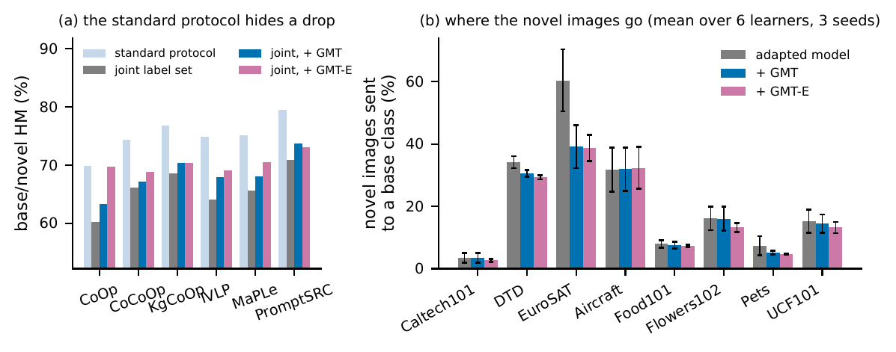
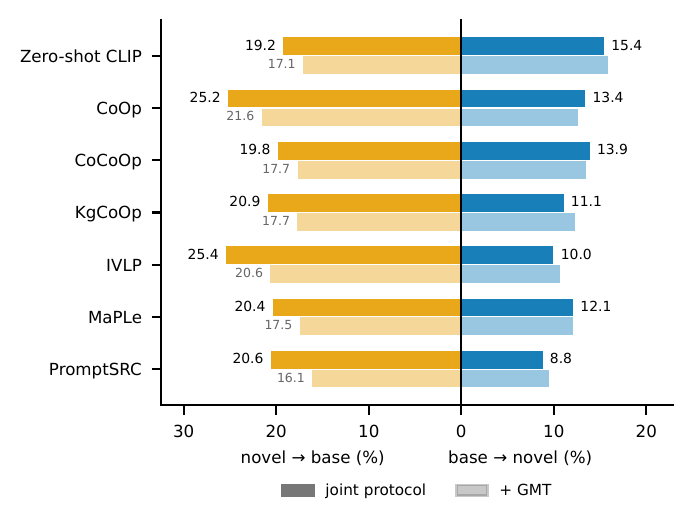
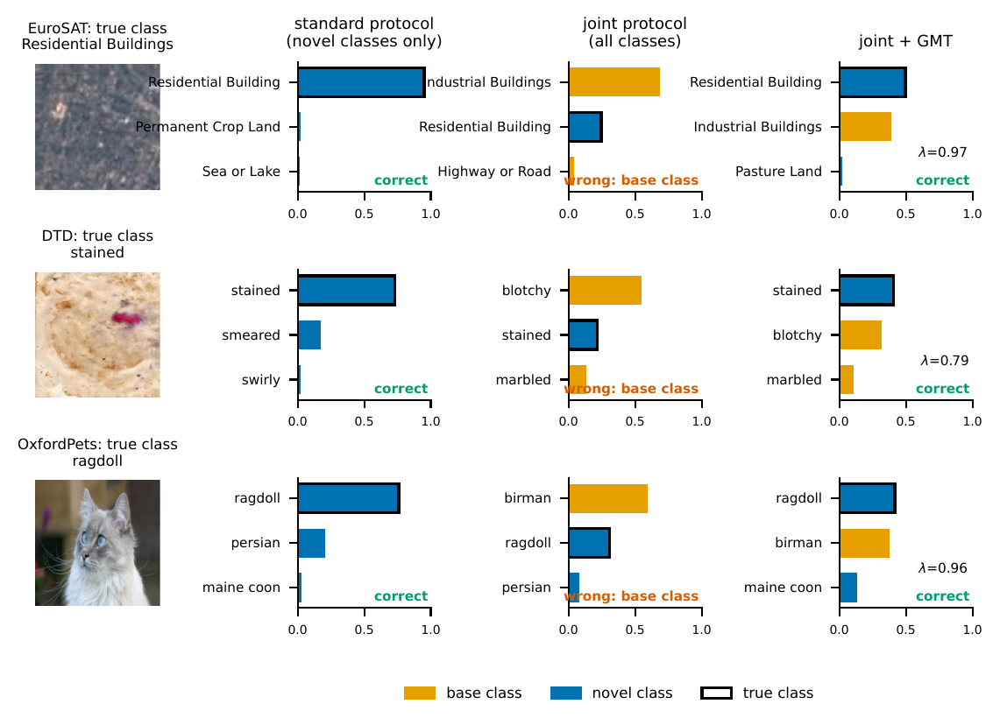
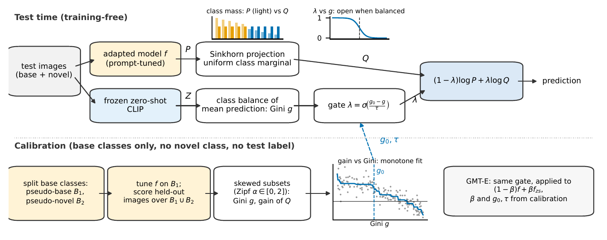
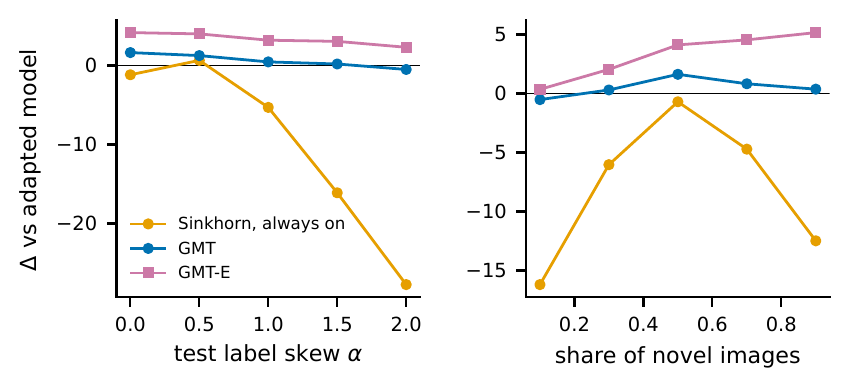

# Gated Marginal Transport (GMT)

Code for the anonymous CVPR 2027 submission
**When All Classes Compete: Base-Class Bias in Prompt-Tuned CLIP and a Gated, Label-Free Correction**.

## The problem in one figure

Prompt learning adapts CLIP to a few labelled *base* classes, and the base-to-novel benchmark checks that the model still recognises unseen *novel* classes.
The benchmark scores base and novel images against **separate** label sets, so the model is told which group every image comes from.
A deployed model is not told this: every image competes against **all** classes.

*(a) Base/novel HM of six prompt learners under the standard protocol, in the joint label set, and after GMT and GMT-E. (b) Share of novel test images that the adapted model assigns to a base class.*

## The bias has a direction

Zero-shot CLIP makes errors across the base/novel boundary in both directions.
Prompt-tuned models make them mostly in one direction: novel images are sent to base classes.

What this looks like on single images: the standard protocol (novel classes only) gets them right, the joint label set sends them to a similar base class, and GMT restores the novel class.

## The method

**At test time** (no training, no labels):
1. Take the softmax predictions `P` of the adapted model for a batch of test images.
2. Project them onto a uniform class marginal with Sinkhorn iterations, giving `Q`.
3. Read the class balance of the predictions of **frozen zero-shot CLIP** on the same batch (Gini coefficient `g`). Prompt tuning does not change this head, so a skewed `g` signals a skewed test set.
4. Blend in log space, `(1 - λ) log P + λ log Q`, with gate `λ = σ((g0 - g) / τ)`: the projection is applied when the batch looks balanced and switched off when it does not.

**Calibration** (once per dataset, base classes only): split the base classes into pseudo-base and pseudo-novel halves, tune the learner on the pseudo-base half, draw class-skewed subsets of held-out base images, and fit `g0` and `τ` from the gain of the projection against `g`. No novel class and no test label is used.

**GMT-E** applies the same procedure to an ensemble of the adapted and zero-shot logits.

## Safe under label shift

An always-on projection assumes balanced test classes and fails badly when they are not.
The gate closes under skew, so GMT stays close to the uncorrected model.

## Layout
- `trustprompt/`: datasets, CLIP prompt learners (CoOp, CoCoOp, KgCoOp, IVLP, MaPLe, PromptSRC) and training engine.
- `run_textprompt.py`, `dump_logits.py`: train a learner and save test logits (adapted and zero-shot).
- `correct_bias.py`, `adaptive_correct.py`: Sinkhorn projection, Gini gate and GMT.
- `calibrate_mixed.py`, `run_calib.sh`: label-free calibration of the gate on pseudo-splits.
- `baselines_cs.py`, `extra_baselines.py`, `ablate_gate.py`, `analysis_suite.py`, `supp_analyses.py`, `batch_test.py`: baselines, ablations and analyses.
- `newdata_analysis.py`, `run_newdata.sh`: datasets never used for calibration.
- `make_assets.py`: builds every table, figure and in-text number of the paper from `runs/`.

## Setup
Python >= 3.9, PyTorch, OpenAI CLIP (`pip install git+https://github.com/openai/CLIP.git`), numpy, scipy, matplotlib and POT (`pip install pot`).
Datasets follow the CoOp layout and base/novel splits; see `scripts/download_data.sh` and check them with `python scripts/check_data.py`.

## Reproducing the paper
1. Train each learner and save logits: `run_tp.sh` / `run_learner.sh` (arguments in the script headers), or `run_seed.sh` for all seeds.
2. Calibrate the gate on pseudo-splits: `run_calib.sh`.
3. Corrections, baselines and ablations: `post_learner.sh`, then `python extra_baselines.py`.
4. New datasets: `run_newdata.sh`, then `python newdata_analysis.py`.
5. Tables, figures and numbers: `python make_assets.py` (writes `paper_assets/`).

Every number in the paper is produced by `make_assets.py`; nothing is typed by hand.
